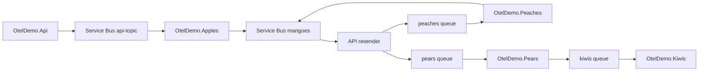

# OpenTelemetry Distributed Messaging Patterns Demo

This project demonstrates OpenTelemetry patterns for .NET services using Azure Service Bus, an OpenTelemetry Collector, and the Aspire Dashboard.

The demo focuses on traces, logs, metrics, baggage, async messaging propagation, Activity Links, fan-out, and real Service Bus retries.

## Services

- `OtelDemo.Api`: HTTP API that starts workflows and routes messages.
- `OtelDemo.Apples`: subscribes to `api-topic` and starts downstream work.
- `OtelDemo.Peaches`: processes the peaches queue and forwards work.
- `OtelDemo.Pears`: processes the pears queue and forwards work.
- `OtelDemo.Kiwis`: final processor that demonstrates HTTP client spans and external dependency failures.
- `oteldemo.collector`: receives OTLP and exports to Aspire.
- `oteldemo.dashboard`: Aspire Dashboard.
- `emulator`: Azure Service Bus emulator.

## Run

```powershell
docker compose up --build
```

URLs:

- API: `http://localhost:8080`
- OpenAPI/Scalar: `http://localhost:8080/scalar/v1`
- Aspire Dashboard: `http://localhost:18888`

Wait for the API health check to pass before running scenarios. The worker services start after the API is healthy.

## Architecture



## Scenario Endpoints

Run any scenario with `POST` and no body:

```powershell
Invoke-RestMethod -Method Post -Uri http://localhost:8080/scenarios/linear-trace
```

The response includes a `workflowId`, message IDs, the Aspire URL, and a search hint.

Available scenarios:

- `POST /scenarios/linear-trace`: parent-context propagation creates one linear distributed trace.
- `POST /scenarios/linked-trace`: each async hop starts a new trace connected with Activity Links.
- `POST /scenarios/batch`: publishes 10 messages in one Service Bus batch.
- `POST /scenarios/fanout`: Apples fans out to both Peaches and Pears.
- `POST /scenarios/retry-then-success`: the first delivery fails, then Service Bus redelivers and the workflow succeeds.
- `POST /scenarios/dead-letter`: processing always fails until Service Bus exceeds `MaxDeliveryCount` and dead-letters the message.
- `POST /scenarios/external-call-failure`: Kiwis records a failing HTTP dependency span but completes the message.

## Demo Scripts

PowerShell scripts live in `scripts`:

```powershell
.\scripts\demo-linear.ps1
.\scripts\demo-linked.ps1
.\scripts\demo-batch.ps1
.\scripts\demo-fanout.ps1
.\scripts\demo-retry.ps1
.\scripts\demo-deadletter.ps1
.\scripts\demo-external-failure.ps1
.\scripts\demo-all.ps1
```

`demo-all.ps1` excludes dead-letter because that scenario intentionally keeps failing until Service Bus dead-letters the message.

## What To Look For In Aspire

Search by the returned `workflowId`.

- Traces: spans named `api.start_process`, `api.new_trace`, `apples.process`, `api.route_message`, `peaches.process`, `pears.process`, and `kiwis.process`.
- Attributes: `demo.workflow_id`, `demo.scenario`, `demo.use_links`, `demo.failure_mode`, `messaging.message.id`, and `messaging.servicebus.delivery_count`.
- Logs: structured logs include workflow ID, scenario, message ID, destination, and delivery count.
- Metrics: custom metrics start with `oteldemo.messages.*`, `oteldemo.retries.observed`, and `oteldemo.processing.duration`.
- Baggage: selected baggage values are copied onto spans as `baggage.workflow.id`, `baggage.demo.scenario`, and `baggage.demo.trace_mode`.

## Teaching Points

- Linear trace: best for simple causality when one async operation is clearly caused by another.
- Linked trace: better for decoupled async messaging where the consumer should start independent work but retain causal links.
- Batch: shows one API operation producing multiple independent message-processing paths.
- Fan-out: shows one workflow splitting into parallel branches.
- Retry: shows real Service Bus redelivery and increasing delivery counts.
- Dead-letter: shows repeated failed processing attempts; the emulator dead-letters after max delivery count.
- External failure: shows dependency failure without message retry by completing the message after recording the error.

## Flexible Endpoint

For custom combinations, use `/start-process`:

```powershell
Invoke-RestMethod -Method Post -Uri http://localhost:8080/start-process -ContentType "application/json" -Body '{
  "useLinks": true,
  "numberOfMessages": 3,
  "startNewTrace": true,
  "batch": false,
  "failureMode": "None",
  "scenario": "custom"
}'
```

`failureMode` values:

- `None`
- `ThrowOnce`
- `AlwaysThrow`
- `SlowProcessing`
- `ExternalCallFailure`

## Build

```powershell
dotnet build
```

The repository currently emits `NU1507` warnings if multiple NuGet package sources are configured. They do not block the build.
